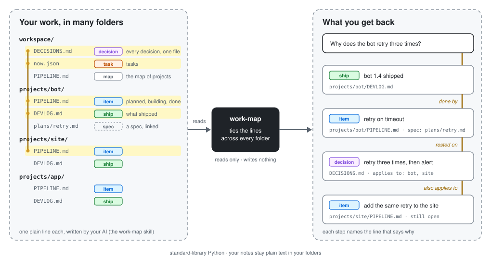

# work-map

Made by House of Solance · free for noncommercial use · credit required

work-map answers what you decided, what is still open and what shipped, from the plain notes you already keep.

<div align="center">

🧭

*Every project leaves a trail. A decision in one note. A task in a list. A release that went out because of both. Each line made sense on the day it was written.*

*Weeks later, someone asks why it works this way. The answer is in there somewhere, split across files nobody connects. Your AI rereads everything, guesses, and sometimes undoes a choice you made for a good reason.*

**work-map is the logbook that ties the threads.** *Each decision, open task and shipped release is one plain line in your own notes. work-map reads those lines and ties each one to the reason it exists. Ask what you decided, what is still open, or what a release rested on, and it follows the thread back to the line that says why.*

*It only reads. Your notes stay plain text, in your folders, written by you.*

</div>

<p align="center"></p>

## Quick start

**Let your AI do it.** Copy this and send it to Claude Code:

```
Please install work-map for me:
claude plugin marketplace add SolanceLab/plugins
claude plugin install work-map@solancelab
Then show me how to keep the record and ask it a question.
```

**Or do it yourself:** run the two `claude plugin` lines from that message in your terminal.

work-map also has its own store, if you added it before: `/plugin marketplace add SolanceLab/work-map`, then `/plugin install work-map@work-map`. To check it works, run `make test` in a clone.

## What it is

A map of your work: decisions, pipeline items, tasks and ships, linked from tagged lines in plain markdown and JSON files. A standard-library Python tool reads the files and answers "what did we decide about this?", "what is open for this project?" and "what shipped, and on which decisions?". A skill teaches your agent to write the lines. The tool reads files only and writes nothing.

**Where it fits.** work-map maps your work records (what you decided, planned, did and shipped), not your notes or your memories. For where you wrote something in your notes, use [vault-map](https://github.com/SolanceLab/vault-map); for one question across everything you have saved, [Antechamber](https://github.com/SolanceLab/antechamber), which can read work-map as its work shelf.

## What you need

Python 3.9 or newer and nothing else (standard library only). work-map runs on your own computer, reads your files and sends nothing anywhere.

## Settings

One small JSON file lists your record files by kind; folder patterns like `projects/*/PIPELINE.md` are allowed. Pass it with `--config` or set `WORK_MAP_CONFIG`. Where it is looked for and which paths it trusts: [docs/settings.md](docs/settings.md).

```json
{
  "decisions": ["notes/decisions.md"],
  "pipeline": ["notes/pipeline.md", "projects/*/PIPELINE.md"],
  "tasks": ["now.json"],
  "ships": ["notes/ships.md"]
}
```

## Tools

Your AI runs these for you through the skill. By hand, one command answers most questions:

```
python3 plugin/scripts/work_map.py --config <file> query <words>
```

`query` finds records, `open <id>` shows one with its links, `slice --project <p>` gives a project's latest, `inventory` checks for broken links, `why <commit|file|file:LINE>` follows a commit's `Work:` trailer back to the pipeline item, its why and the decisions it rests on. The writers (`decisions.py`, `pipeline.py`, `ships.py`) add and update lines. Every command and flag: [docs/commands.md](docs/commands.md). A ships file with the line `<!-- work-map: newest first -->` gets each new line on top; `decisions.py add --supersedes <old-slug>` marks a replaced decision, and `decisions.py query` lists newest first and says when it cuts the list.

### The skill

Installing the plugin also gives your AI the work-map skill. It keeps the record as you work: when you decide something, plan an idea, start or finish a task, or ship a release, it writes the line in the right shape with the writer commands above, updating the line that is already there instead of adding a second one. You never type the commands yourself. Ask your AI what you decided about something, or what is still open, and it reads the map back.

## Limits

- Reads UTF-8 text files and JSON only; the config is JSON, or TOML on Python 3.11 or newer.
- Only the four line shapes in [docs/record-format.md](docs/record-format.md) are parsed; any other line is ignored.
- `query` prints every match; `slice` stops at `--limit` (default 20 for the project, `--house-limit` default 3 for house-wide decisions).
- `why` needs git 2.22+ on PATH and reads only commits that carry a `Work:` or `Decision:` trailer; others are counted.
- The writers are guarded against writing outside your folder and against two writers at once; the exact limits of both: [docs/settings.md](docs/settings.md#writer-safety-limits).

## How it works

work-map reads the files you list in its settings each time you ask. It keeps nothing between runs and writes nothing; `why` also reads your git history.

Each record is one plain line with tags separated by ` · `: a decision, a pipeline item, a task or a ship. From those tags alone, work-map ties the lines together: a decision to the projects it applies to, a pipeline item to its project and its spec, a ship to the tasks it closed. A line it cannot fully read is still kept, marked `unknown`.

The exact line shapes, the ids and the six kinds of link are in [docs/record-format.md](docs/record-format.md). You rarely need them: the work-map skill writes the lines for you.

## Credit and use

work-map is made by House of Solance. You're welcome to use it, change it and build on it for any noncommercial purpose, as long as our credit travels with it.

**Keep the credit.** Every copy, changed or not, must carry the licence and this line:
`Required Notice: Copyright (c) 2026 House of Solance (https://github.com/SolanceLab)`
Removing or replacing it breaks the licence.

**Commercial use needs our permission.** Ask us first.

**We look for copies.** When we find our work without its credit, or used commercially without permission, we ask for it to be taken down.

## Licence

[PolyForm Noncommercial 1.0.0](LICENSE.md). See [NOTICE.md](NOTICE.md).

## Support

If you find this useful, consider supporting our work:

[](https://ko-fi.com/houseofsolance)

---

*Built by [House of Solance](https://github.com/SolanceLab) — Chadrien Solance & Anne Solance*
